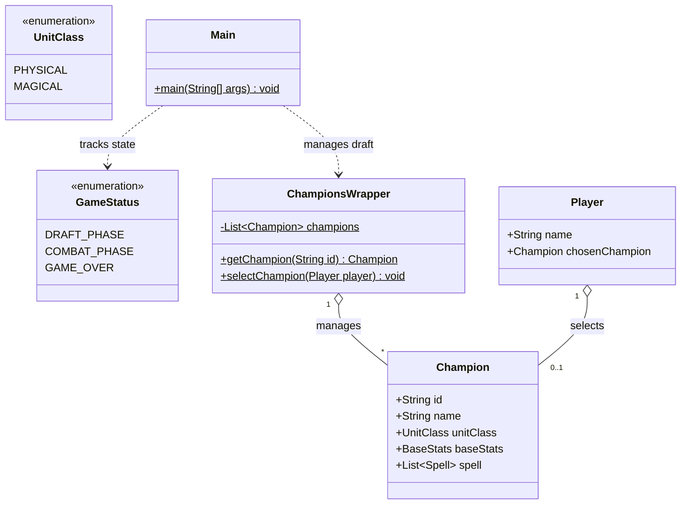

# Java Terminal RPG Combat Engine

A turn-based command-line combat game built in Java. Players compete in a champion draft before entering a tactical arena with turn upkeep, cooldown management, and status effects.

## Mechanics

- **Draft Phase:** Players take turns selecting unique champions from a JSON data file.
- **Upkeep Phase:** At the start of every turn, active status effects tick, cooldowns decrement, and death conditions resolve before player action.
- **Turn Actions:** Choose between auto-attacks to generate mana or specialized spells with distinct cost and cooldown constraints.
- **Stat Engine:** Tracks health pools, mana scaling, damage modifiers, and status effects (poison, burn, stun, shield, heal, execution thresholds).

## Architecture

The project separates game state management, utility wrappers, and UI formatting:

- `Main`: Coordinates phase transitions (`DRAFT_PHASE`, `COMBAT_PHASE`, `GAME_OVER`).
- `ChampionsWrapper`: Handles JSON parsing via Jackson, champion lookup, and player selection commands.
- `Champion` & `BaseStats`: Defines entity stats, auto-attacks, and available spell sets.
- `GameInfo`: Manages console outputs and turn status updates.



## Requirements

- Java 17 or higher
- Maven 3.6+
- Jackson Databind library (defined in `pom.xml`)

## Quick Start

1. **Clone the repository:**

   ```bash
   git clone https://github.com/your-username/your-repo-name.git
   cd your-repo-name
   ```

2. **Build the project:**

   ```bash
   mvn clean package
   ```

3. **Run the game:**
   ```bash
   java -cp target/your-built-jar-file.jar org.combat.game.Main
   ```

## Configuration

Champion stats, abilities, and multipliers are stored in `src/main/utils/champions.json`. You can modify base attributes or add new champions directly in that file without altering core game logic.
